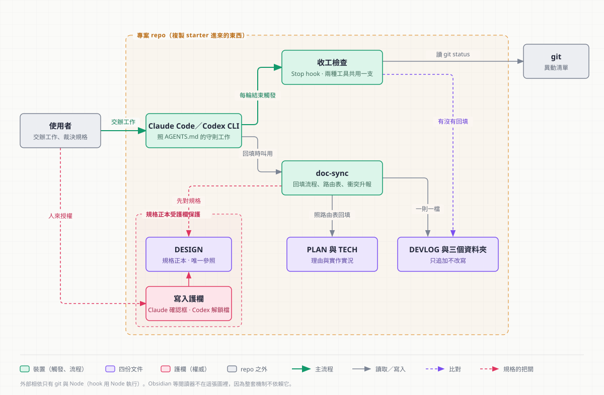

# ChiaoFlow — a documentation workflow for projects built with AI coding agents

[繁體中文](README.md) | **English**

> **Status: reference snapshot, not maintained.**
> This repository is published as a portfolio reference. It is a cleaned-up snapshot of a private
> working repository, so it has no development history, and it will not receive updates.
> Issues and pull requests are not monitored.

**Keep what was written down readable by someone else, later.**

ChiaoFlow is a small documentation workflow for projects built together with AI coding agents
(Claude Code and Codex CLI). Four documents with strictly separate jobs, plus a check that runs
before the agent finishes a turn, keep the docs from falling behind the code and keep the spec
from being quietly rewritten to match the implementation.

This page is an English overview. The handbook, the install guide and the worked examples are
written in Traditional Chinese; the links below point to them.

## The problem

Three things go wrong as a project runs on:

| Problem | What it looks like | How ChiaoFlow handles it |
|---|---|---|
| **Docs fall behind the code** | Three months later the docs describe something that no longer runs, so nobody trusts them | A Stop hook blocks the end of the turn until the records are updated |
| **The "why" behind a decision is lost** | Nobody remembers why it was built this way, and the same mistake is made again | The log is append-only, and every entry has to state its reason |
| **The spec is eroded by the implementation** | When code and spec disagree, editing the spec is the cheapest fix, so the spec slowly becomes a description of the code | The spec is the single reference, and writes to it need a human's approval |

The third one is the hardest to notice because it has no symptom: docs and code always agree,
but the spec no longer records anyone's intent.

## Four documents, one job each

The rule is that one fact is written in one place only.

| Document | Answers | Maintained how |
|---|---|---|
| `doc/DESIGN.md` | **What** is being built: mechanics, spec, parameters | Edited in place; changes need approval |
| `doc/PLAN.md` | **Why this route**: technical choices, schedule, risks, rejected options and why | Edited in place |
| `doc/TECH.md` | **How it is built**: data contracts, module interfaces, invariants, how to verify | Follows the code |
| `doc/DEVLOG.md` with `devlog/`, `decisions/`, `gotchas/` | **What happened when**: progress, decisions, pitfalls | Append-only, one entry per file |

`README.md` stays at the project root as a thin entry point that links into `doc/`.

## Three mechanisms

Written rules get skipped, because they only exist as text. Each mechanism covers one gap.

| Layer | What it prevents | Claude Code | Codex CLI |
|---|---|---|---|
| **Authority** | The agent rewriting the spec on its own | `permissions.ask` shows a confirmation prompt | A PreToolUse hook blocks the write until a person creates an unlock file |
| **Trigger** | Ending a turn with code changed and records untouched | `hooks.Stop` | `[[hooks.Stop]]` |
| **Procedure** | Guessing where each change should be recorded | `doc-sync` skill | the same `doc-sync` skill |

The trigger and procedure layers are shared: both tools run the same script and read the same
skill file. Only the authority layer differs, because Codex hooks cannot ask a person to confirm.

When code conflicts with `DESIGN.md`, the agent stops and reports it, and a person decides which
side changes. The default assumption is that the spec is right.

## What is in this repository

| Folder | Contents |
|---|---|
| [core/](core/) | **ChiaoFlow Core.** [core/starter/](core/starter/) is what gets copied into a project; [core/安裝.md](core/安裝.md) is the install guide (about 20 minutes: copy, change four places, run three checks) |
| [setup/](setup/) | Prerequisites: installing Claude Code or Codex CLI, and Python for a few optional features |
| [extras/](extras/) | Optional tooling for diagrams and slide decks. Core and Extras do not depend on each other |
| [examples/](examples/) | What an installed project looks like: a fictional Unity feature, and this repository's own records |

The full handbook, which explains why each part is designed the way it is, is [README.md](README.md).

## Where it came from

ChiaoFlow was distilled from my own side projects, mainly game jams and short prototypes, starting
in August 2026. These projects are short, involve an AI agent, and are often handed to a
collaborator or left for a while, which is when documentation decays fastest. The direct starting
point was one of those prototypes; later changes each came from a gap found while using it on
another project.

## License

[MIT](LICENSE)
