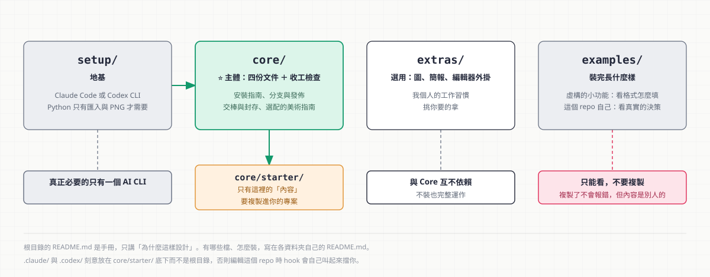
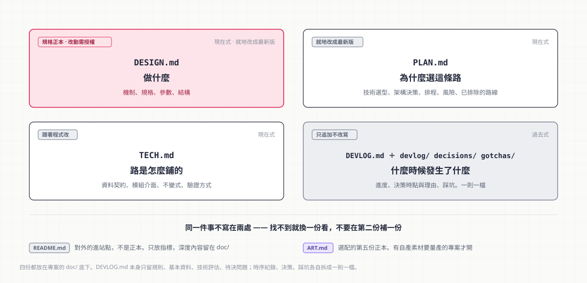
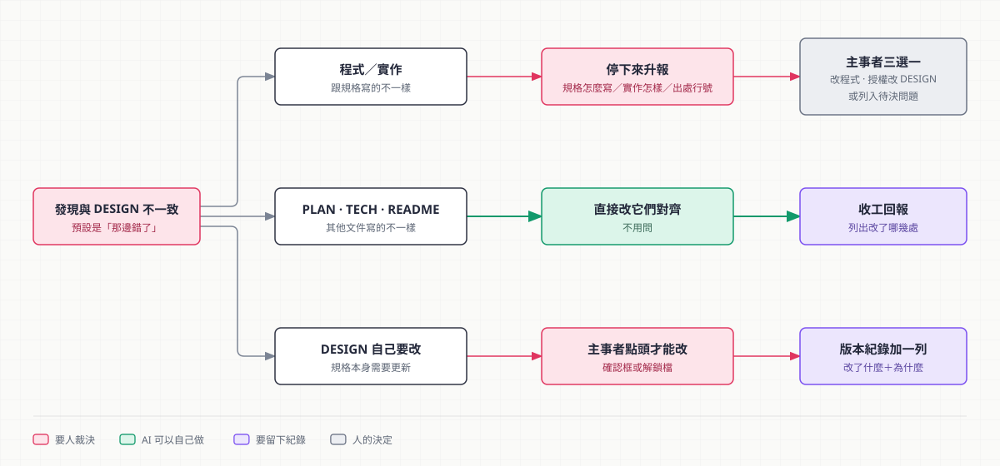
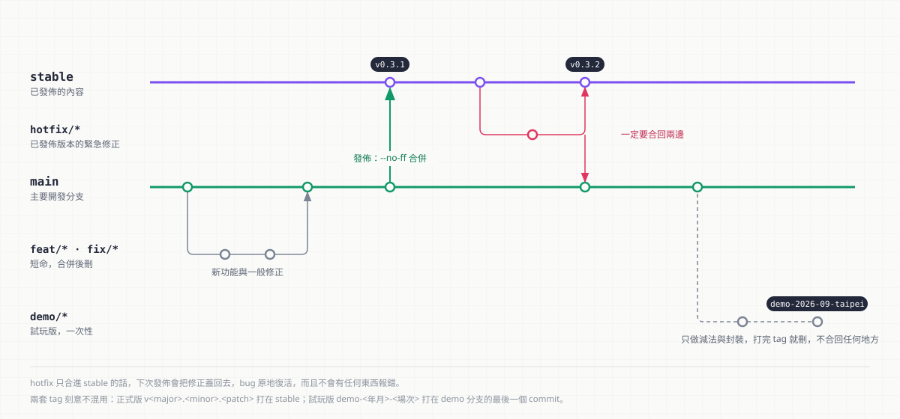

# ChiaoFlow —— 我的文件工作流程

**讓一件事被寫下來之後，還能被別人看懂。**

> **In English:** ChiaoFlow is a small documentation workflow for projects built together with
> AI coding agents (Claude Code and Codex CLI). Four documents with strictly separate jobs,
> plus a check that runs before the agent finishes a turn, keep the docs from falling behind
> the code and keep the spec from being quietly rewritten to match the implementation.
> Setup takes about 20 minutes per project. The docs themselves are written in Traditional Chinese.


這一包分成兩半，**只有第一半是我真心推薦的**：

|                      | 是什麼                                      | 在哪裡                |
| -------------------- | ---------------------------------------- | ------------------ |
| ⭐ **ChiaoFlow Core** | 四份文件 ＋ 一道收工前的檢查。讓文件不落後於程式、規格不被實作反向侵蝕     | [core/](core/)     |
| **ChiaoFlow Extras** | 圖、簡報、編輯器外掛。**全部選用** —— 這些是我個人的工作習慣，挑你要的拿 | [extras/](extras/) |

裝 Core 在一個專案上約 20 分鐘（複製 [core/starter/](core/starter/) 整份、改四處、跑三個驗證）。
Core 與 Extras **互相沒有依賴**，可以只裝一邊。

**Core 同時支援 Claude Code 與 Codex CLI**，兩者共用同一份守則、同一支收工檢查腳本、
同一份回填流程 —— 裝一邊或兩邊都裝都行。差異只有一處（規格正本怎麼擋），見「三層裝置怎麼運作」。
Extras 則有幾項只在 Claude Code 下有現成路線，那一節會標明。

歸納自我自己做 side project 的經驗，主要是 Game Jam 與短期 prototype（2026-08 起）。「來歷」那節有始末。
授權是 [MIT](LICENSE)。

---

## 你該從哪裡開始

**本手冊只講「為什麼這樣設計」。安裝步驟寫在各資料夾裡，這裡不複製一份。**

| 你的情況 | 去哪 | 大約耗時 |
|---|---|---|
| 還沒裝 AI CLI（Claude Code 或 Codex，擇一或都裝） | [setup/](setup/) —— 兩邊的共同前置，前置需求清單也在那裡 | 15 分鐘 |
| **想在專案裡裝文件體系** | **[core/安裝.md](core/安裝.md)** ⭐ 多數人要的是這個 | 20 分鐘 |
| 想順便裝 Obsidian、接 MCP、從 Notion 搬既有文件 | [core/README.md](core/README.md) 的決策表 | 看專案狀況 |
| 想要產圖、做簡報的工具 | [extras/](extras/) | 全部選用 |
| 想定分支怎麼開、版本怎麼推出去 | [core/分支與發佈.md](core/分支與發佈.md) | 10 分鐘 |
| prototype 做完了，要交棒或收攤 | [core/交棒與封存.md](core/交棒與封存.md) | 10 分鐘 |
| 想先看裝完長什麼樣 | [examples/](examples/) | 5 分鐘 |
| 想知道為什麼這樣設計 | 繼續往下讀 | |

> ## ⚠️ 裝完有一個不能省的步驟
>
> **一定要 `git commit`**。未追蹤的 `doc/` 在 `git status` 裡恆為「有異動」，
> 收工閘門恆通過 —— **第一次 commit 之後才真的開始擋。**

---

## 0. 這套東西解決什麼問題

專案做著做著，會出現三種病：

| 病 | 症狀 | 這套怎麼治 |
|---|---|---|
| **文件落後於程式** | 三個月後翻文件，寫的跟跑的不一樣，於是沒人再信文件 | Stop hook 擋在收工前，沒回填就結束不了 |
| **決策的「為什麼」蒸發** | 「這裡為什麼要這樣寫？」沒人記得，於是又踩一次同樣的坑 | DEVLOG 只追加不改寫，每則強制寫理由 |
| **規格被實作反向侵蝕** | 實作跟規格對不上時，改規格最省事 —— 於是規格慢慢變成實作的註解 | DESIGN 為唯一參照 ＋ 權限規則鎖住規格正本 |

第三種最陰險，因為它**沒有症狀**。文件跟程式永遠一致，只是那份「規格」已經不再是任何人的意圖了。

### 什麼時候值得用

- 有 AI 參與、而且會**連續幾週**動同一份程式
- 有「當初為什麼這樣決定」值得留的判斷（技術選型、被否決的路線）
- 有一份**規格是有權威的** —— 也就是說，程式偏離規格算是 bug，不是既成事實

### 什麼時候不值得

| 情況 | 為什麼別用 |
|---|---|
| 一次性腳本、練習專案 | 四份文件的維護成本高於收益，寫一份 README 就好 |
| 沒有明確主事者、規格靠共識滾動 | 「DESIGN 是唯一參照」會變成吵架的引信 |
| 純探索期、每天推翻昨天 | 先探索，穩定了再上這套 |

---

## 1. 這個 repo 的結構



四個資料夾，各一個概念：**裝什麼／主體／選配／看範例**。

```
README.md   本手冊（你正在讀的這份）—— 講「為什麼這樣設計」
setup/      地基：Claude Code CLI／Codex CLI（擇一或都裝）、三層設定檔；
            Python 只有匯入／PNG 匯出才需要
core/       ⭐ ChiaoFlow Core —— 多數人要的是這個
  starter/    ⭐ 要複製到你專案的東西：AGENTS.md（守則正本）＋ .agents/（兩種工具
              共用的 hook 與 doc-sync skill）＋ .claude/ 與 .codex/（各自的接線）
              ＋ doc/ 四份正本骨架 ＋ README.骨架.md（進站點骨架，用完刪掉）
  安裝.md     ⭐ 必要 —— 複製、要改的四處、三個必跑的驗證
  Obsidian環境.md  MCP連結.md  Notion匯入.md  交棒與封存.md      全部選用
  美術指南.md ＋ 選配/  選配的第五份正本 ART.md：何時開、怎麼接、怎麼寫 ＋ 骨架
  工具/連結檢查.py   掃全 repo 的相對連結（壞掉的引用不會報錯，所以要有人掃）
  圖/               手冊與安裝指南用的說明圖（手寫 SVG，純文字、diff 得出來）
extras/     ChiaoFlow Extras —— 全部選用，不依賴 Core
  圖表工具.md   VSCode外掛.md
  簡報/       ⭐ 五階段：出大綱 → 出內容 → 出視覺 → 整合成 pptx → 手修
examples/   裝完長什麼樣，可直接用 Obsidian 打開
  unity-道具掉落/   虛構的小功能，看格式怎麼填
  doc-system-kit/   這個 repo 自己，內容全部真實
```

**有哪些檔、怎麼裝，看各資料夾自己的 `README.md`。** 本手冊不維護第二份清單 ——
維護兩份的下場是它們一定會分岔。

### 三個容易誤會的地方

| 誤會 | 實際上 |
|---|---|
| 「要複製 `core/` 整包進專案」 | ⛔ **只複製 [core/starter/](core/starter/) 的內容**：`cp -r core/starter/. <專案路徑>/`。複製的是內容不是資料夾，所以 `starter` 這個名字不會出現在你的專案裡 |
| 「`examples/` 也要複製」 | ⛔ 那是**只能看的**。複製過去你會得到別人專案的內容，而且**不會報錯** |
| 「`.claude/`／`.codex/` 怎麼在 `core/starter/` 底下」 | 刻意的。放這個 repo 的根目錄的話，你在編輯這一包時 hook 會自己叫起來擋你 |
| 「`.agents/`、`.claude/`、`.codex/` 是三份要各自維護的設定」 | ⛔ 只有 `.agents/` 是正本（hook 腳本、doc-sync skill）。`.claude/` 與 `.codex/` 只是把它接到各自工具上的薄薄一層，加起來不到 50 行 |

> **地基裡真正必要的只有一個 AI CLI**（Claude Code 或 Codex，擇一即可）。
> Python 只有三個可選功能會用到
> （Mermaid／draw.io 匯入、PNG 匯出、匯入現成 `.pptx`），Core 完全不碰它。

**Core 與 Extras 之間沒有任何依賴關係** —— 不裝 Core 也能用 Extras，不裝 Extras 的話 Core 也完整運作。
放在同一個 repo 是因為它們服務同一件事：**讓一件事被寫下來之後，還能被別人看懂。**
為什麼要有 Extras，見「為什麼一份講文件的手冊要管圖與簡報」。

---

## 2. 四份文件的分工



**核心紀律：同一件事不寫在兩處。** 找不到就換一份，不要在第二份補一份。

| 文件 | 回答什麼 | 時態 | 維護方式 |
|---|---|---|---|
| `doc/DESIGN.md` | **做什麼** —— 機制、規格、參數、結構 | 現在式 | 就地改成最新版，**改動需授權**（見「DESIGN 是唯一參照」） |
| `doc/PLAN.md` | **為什麼選這條路** —— 技術選型、架構決策、排程、風險、驗收、**已排除的路線與排除原因** | 現在式 | 就地改成最新版 |
| `doc/TECH.md` | **路是怎麼鋪的** —— 資料契約、模組介面、**不變式**、驗證方式 | 現在式 | 跟著程式改 |
| `doc/DEVLOG.md` ＋ `devlog/` `decisions/` `gotchas/` | **什麼時候發生了什麼** —— 進度、決策時點、踩坑 | 過去式 | **只追加不改寫**。時序 entry／決策／踩坑各自**一則一檔**，`DEVLOG.md` 本身只留規則、基本資料、技術評估、待決問題（為什麼這樣拆，見「文件的物理形態」） |

### 第五份不是正本：`README.md` 是進站點

`README.md` 留在根目錄，**不要塞進 `doc/`**。它的讀者跟那四份不一樣 ——
四份是給做事的人與 AI 看的，README 是給**還沒碰過這個專案的人**看的。

必備三節：**這是什麼**、**怎麼跑起來**、**文件在哪**（章節規範的正本在
[`doc-sync/SKILL.md`](core/starter/.agents/skills/doc-sync/SKILL.md) 的
「README 的必備章節」，本手冊不複製一份）。

**它要薄。** 檔案清單、資料契約、驗證判準一律留在 `doc/`，README 只放連結 ——
抄一份進去的下場是兩邊分岔，而**分岔的時候不會有任何工具報錯**：
README 會慢慢變成一份看起來很完整、但已經不對的說明。又是第 0 節那第三種病。

> **README 的「怎麼跑起來」跟 TECH 的「30 秒驗證」不是同一件事**：
> 前者是**第一次把它跑起來**，後者是**確認它還沒壞**。受眾與問題都不同，
> 所以兩邊都要有 —— 但那段指令與判準不要抄成兩份。

### 選配的第五份：`doc/ART.md` 美術指南

跟 README 正好相反：**它是正本，但不是每個專案都有**。管的是「畫起來長什麼樣、怎麼畫」——
風格方針、尺寸、繪製規矩、製程、自檢表。有自產素材要量產的專案才開，
**但每個專案開工時都要判斷過一次**（starter 的 PLAN「素材需求與版權」留了那一格）。

它**不是規格正本**：尺寸要升級成規格得寫進 DESIGN、需授權。
何時開、接上要改哪幾處、怎麼寫，見 [core/美術指南.md](core/美術指南.md)。

### 三個容易搞混的邊界

| 疑問 | 答案 |
|---|---|
| PLAN 跟 TECH 差在哪 | PLAN 是**還沒做時的方向與理由**（為什麼不用 Unity）；TECH 是**做完後的實況**（介面對照表）。同一個決定，PLAN 寫「為什麼選」，TECH 寫「長什麼樣」 |
| DEVLOG 跟 PLAN 差在哪 | DEVLOG 只記「何時定案、為什麼」，**內容本身放對應正本**。DEVLOG 不該有可以複製去執行的規格 |
| 舊決策被推翻了怎麼辦 | DEVLOG **不刪不改**：舊 entry 保留，舊決策檔只把 frontmatter 的 `status` 標成「已推翻」，新的那則用 `supersedes` 指回來。被推翻的決策比生效的更有參考價值 —— 它記錄了「這條路試過，不行」 |

### TECH 的「不變式」是這四份裡最值錢的一節

專門收**破壞後不一定馬上看得出來**的約束。例如：

> `window.PROTO` 必須存在 —— 模組作用域不是全域作用域，拆掉它，`onclick` 與截圖驅動會**安靜地**全部失效。

**判準**：如果一條約束被違反後會立刻爆錯，不用寫（錯誤訊息會告訴你）。
要寫的是**違反後還能跑，但已經壞了**的那種。

---

## 3. 核心原則：DESIGN 是唯一參照



這是整套體系的骨幹，其餘裝置都是為了讓它跑得動而存在。

**規則 A（權威）**：`doc/DESIGN.md` 是唯一參照。任何程式或其他文件與它牴觸，
**預設是那邊錯了**，不是 DESIGN 過時了。

**規則 B（衝突分流）**：程式牴觸 → **停下來升報**，等主事者裁決，AI 不自行決定哪邊該改；
PLAN／TECH／README 牴觸 → 以 DESIGN 為準直接改那幾份對齊，不用問，但要在回報裡列出改了哪幾處；
DESIGN 自己要改 → 一定要主事者點頭，且必須在版本紀錄寫「改了什麼＋為什麼」。

**規則 C（事前攔截）**：動程式**之前**先確認 DESIGN 怎麼寫。
如果需求本身就跟 DESIGN 牴觸，先講 —— 不要做完才發現。

升報用的那張表（規格怎麼寫／實作變成怎樣／出處，加三個選項，出處要給到行號）不抄在這裡 ——
正本在 [`doc-sync/SKILL.md`](core/starter/.agents/skills/doc-sync/SKILL.md) 的「升報格式」，
分流表在同一份的「衝突分流」。

> **為什麼規則 A 要寫成「預設那邊錯了」而不是「兩邊都要檢查」**：
> 因為「兩邊都可能錯」在實務上等於「改文件比較快」。預設方向必須偏向保護規格，
> 否則這條原則會在第一次趕時間的時候失效。

規則本體寫在 `doc/DESIGN.md` 開頭（正本一處），`SKILL.md` 與 `AGENTS.md` 只放指標 ——
**本手冊也一樣。**

---

## 4. 回填為什麼會貴

流程本體在 [`doc-sync/SKILL.md`](core/starter/.agents/skills/doc-sync/SKILL.md) ——
動筆順序、五條護欄、落點路由表都在那份，它就是給 AI 讀的正本。這裡只講**為什麼**。

一句話版的順序：**先撈 commit body → 先對規格 → 有牴觸就停下升報 → 才回填 → 回報一張表。**
用實際日期（`date +%F`），不要寫「昨天」「上週」。

### 4.1 貴的不是打字，是考古

> 這一節解的是最常見的抱怨：**「回填花的時間總是比預想多很多」**。

來源專案量到的形狀：功能 commit 幾乎不帶文件（某則 `code 1161 行 / doc 0 行`），
然後每隔幾個 commit 出現一次爆發式回填（`code 10 行 / doc 566 行`），
而那一次要涵蓋前面兩個 commit、共 1360 行程式。更直接的證據是時間戳 ——
連續四個 commit 落在同一分鐘區間裡，那不是「做完一個功能回填一次」，是「攢一整天再一次推」。

批次回填時「當初為什麼這樣決定」已經不在腦子裡，只能從 diff 反推。
**反推一個兩天前的決策，比當下記下來貴 5～10 倍**，而且經常推不出來
（於是 DEVLOG 只剩流水帳，正好是它最沒價值的形態）。

這就解釋了那個抱怨：**你預估的是「寫下我剛做的事」的時間，實付的是「重建三天前的心智狀態」的時間。**
兩者差一個數量級，而你每次都用前者估。

**解法是把「為什麼」的產出時機前移到 commit：**

> 做了任何有「為什麼」的決定，commit body 就要有一行 `決策：X／因為 Y`。

回填時 DEVLOG 的「決策」段就從**考古**降級成**搬運**。
什麼情況該寫、body 的格式長什麼樣，見 SKILL.md 的「commit 的時候要做的事」。

⚠️ **反向護欄**：commit body 不是 DEVLOG 的替代品，是它的**原料**。
body 散在 `git log` 裡、沒有結構、也不會被決策表收攏。兩者是「原料 → 成品」，不是二選一。

### 4.2 收件匣：把「該歸到哪一節」的判斷延後

TECH 長到十幾節、幾萬字之後，回填的成本會從「寫」轉移到**「定位與判斷」**：
一次程式改動常要判斷五、六次「這條該進檔案清單還是模組契約還是驗證章節」，
每次都得把整份結構重新載進腦子，判斷錯了還要重來。

**解法**：TECH 開一節**收件匣**，放在**最後**（這樣新增它不會讓任何既有章號位移 ——
正好是「文件的物理形態」要治的病），回填時只寫這一個落點。
規則（內容是現在式、一條一行附落點提示、什麼時候整併、整併是搬不是重寫、
⚠️ 不變式不進收件匣）的正本在 [`starter/doc/TECH.md`](core/starter/doc/TECH.md) 的收件匣章節。

> **這一條與「正本永遠是現在式」有張力，是刻意的取捨。** 收件匣裡的內容仍然是現在式、
> 仍然是正本，只是還沒分類。用「內容正確但位置未定」換掉「因為要決定位置而寫得少或寫得晚」——
> 後者的代價高得多。

### 4.3 寫判準時綁「名字」，不要綁「數量」

一個小規矩，但它每次違反都會讓文件安靜地失真。

```
❌ 「34 張基準圖裡有 3 張天生不穩定，其餘 31 張逐位元穩定」
✅ 「這具名三張天生不穩定（A／B／C），其餘全部逐位元穩定」
```

前者每加一張就要回頭改好幾處數字，而**沒改到也不會有人發現** ——
判準於是從二元條件退化成模糊敘述。後者跟數量完全脫鉤。

⚠️ **但不能只是把數字刪掉。** 那個 `31` 帶著判準資訊（減掉的是哪三張、為什麼），
直接刪會讓驗收條件變糊。正解是把判準**改綁在具名的例外**上，數量自然就不必寫了。
數量的唯一正本應該是**程式裡的那份清單**，執行時印出來。

**例外**：歷史敘述裡的數字要保留 —— 「某日實測 30 張只有兩張不同」是當時的量測事實，
不是待更新的現況。

---

## 5. 三層裝置怎麼運作

規則寫得再完整也會漏 —— 它只存在於文字裡，靠人（或 AI）在收工時記得。三層各解一件事：

（全貌見本手冊開頭那張圖；圖檔是 [core/圖/三層裝置.svg](core/圖/三層裝置.svg)，機制改了要跟著改。）

| 層 | 解決什麼 | Claude Code | Codex CLI | 為什麼可靠 |
|---|---|---|---|---|
| **權威** | 規格正本不能被 AI 單方面改寫 | `permissions.ask` 跳確認框 | PreToolUse hook 硬擋 ＋ `doc/.design-unlock` 解鎖檔 | 由 CLI 本身執行，**任何權限模式都繞不過** |
| **觸發** | 改了程式卻想結束回答時，擋下來 | `hooks.Stop` | `[[hooks.Stop]]` | 兩邊跑**同一支** `.agents/hooks/doc-sync-check.mjs`，不靠任何人記得 |
| **流程** | 回填的路由表、衝突偵測、升報格式 | `.claude/skills/`（stub） | `.agents/skills/`（正本） | 平常不佔 context，被叫到才載入 |

觸發層與流程層**兩邊完全共用**：Codex 的 Stop hook 契約與 Claude 相同
（stdin 都給 `cwd` 與 `stop_hook_active`，stdout 都吃 `{"decision":"block","reason":…}`），
所以腳本放在工具中立的 `.agents/` 下，一份服務兩個工具，擋下的理由文字一字不差。

守則也只有一份：`AGENTS.md` 是正本，`CLAUDE.md` 只是 `@AGENTS.md` 匯入加兩行專屬補充。

### ⚠️ 權威層是唯一沒辦法共用的一層


Codex 的 PreToolUse hook **只支援 `allow` 與 `deny`** —— 官方把 `"ask"` 標成
*parsed but not supported yet*，也就是你寫了它不會報錯，只會**安靜地不生效**。
那正是第 0 節講的第三種病，所以不能照抄 Claude 那套。

Codex 這邊改成「硬擋 ＋ 解鎖檔」：要改 `doc/DESIGN.md` 就由**人**建一個
`doc/.design-unlock`（空檔即可），改完刪掉。

| | Claude Code | Codex CLI |
|---|---|---|
| AI 想改 DESIGN 時 | 跳確認框 | 直接擋下 |
| 人怎麼放行 | 當場點頭 | 建解鎖檔 |
| 「人點頭」留下什麼 | 什麼都沒留 | 一個看得見的檔 |

換掉之後多了一個好處：**「人點頭」從一個沒有痕跡的按鍵，變成一個具體、
看得見、留得下痕跡的動作。** 代價是人要多做一步。

> ⚠️ **解鎖檔是協作慣例與防呆，不是安全邊界。**
> `design-guard.mjs` 會擋掉「用工具建立解鎖檔」這條最直接的路，
> 但有 shell 與寫入權限的 agent 理論上仍有別的辦法繞過去。
> 要真正強制人類授權，得靠 CLI 的人工 approval，或一個 agent 產不出來的外部憑證。
> **這一層擋的是「忘記」與「順手」，不是惡意** —— 跟「已知邊界」那節
> 說 hook 擋不住惡意是同一個道理。

解鎖檔**必須進 `.gitignore`** —— 它一旦被 commit，這層保護就對所有人永久失效，
而且不會有任何症狀。starter 的 `.gitignore` 已經寫好了。

### hook 的判斷邏輯


```
觸發清單有異動  &&  doc/DEVLOG.md 沒異動  →  decision: "block"
```

拿 DEVLOG 當唯一閘門，是因為文件規則本身就要求「全部都要回這裡補一則」。

### 四個非踩不可的坑（都已寫進腳本）

| 坑 | 症狀 | 解法 |
|---|---|---|
| 少了 `-uall` | 未追蹤的整個 `doc/` 只輸出一行 `?? doc/`，底下的 DEVLOG 抓不到 → 閘門誤判 | `git status --porcelain -uall` |
| 少了 `core.quotepath=false` | 非 ASCII 檔名（`啟動.cmd`）被跳脫成 `\345\225\237...` 比對不到 | `git -c core.quotepath=false` |
| 沒讀 `stop_hook_active` | 連續擋 8 次會被 Claude Code 強制覆蓋，中間一直鬼打牆；Codex 那邊則可能陷入無上限的續跑迴圈 | 為 `true` 時 `exit 0`（**兩種工具都吃這個欄位**） |
| 例外沒吞掉 | 檢查工具本身壞掉（不是 git repo、git 不在 PATH）就卡住工作 | 所有例外一律靜默 `exit 0` |

### 兩個設定上的關鍵

- **權威層是「由人決定」的硬保障** —— Claude Code 不管當下是 `acceptEdits`、`auto` 還是
  什麼模式，AI 要動 `doc/DESIGN.md` 都會跳確認框；Codex 則一律擋下直到人建解鎖檔。
  這條讓規則 A 不只是 AI 的自律。
- **Stop hook 用 exec form**（帶 `args`）而非 shell form。Windows 的 shell form 會走 Git Bash，
  profile 若有無條件 `echo` 就會把那行字塞在 hook 的 JSON 前面導致解析失敗。exec form 直接 spawn，不經過 shell。

hook 用 Node 寫，因為 `.ps1` 在受管企業環境常因未簽章而不能跑，`.sh` 在 Windows 又依賴 Git Bash。Node 兩邊都通。

同一個理由也決定了 `CLAUDE.md` 用 `@AGENTS.md` 匯入而不是做成 symlink ——
Windows 建 symlink 要管理員權限或開發者模式。

### 刻意不做的兩件事

- **不裝 pre-commit git hook** —— `.git/hooks/` 不進版控、換機器要重裝，且 commit 當下被擋很煩。Stop hook 時機更早也更好改。
- **不讓 hook 自己去改文件** —— hook 只做判斷與擋，內容由 AI 在對話裡寫，人看得到也能當場否決。

---

## 6. 驗收：為什麼是這三個驗證

**完整的情境表與指令在 [core/安裝.md](core/安裝.md) 的「驗證」。** 這裡只講為什麼是這三個：

| 驗證 | 為什麼非跑不可 |
|---|---|
| **A. 權威層** | Claude Code 要在 `acceptEdits` 模式下**也**跳確認框；Codex 要真的擋下來。擋不住的話，「規格變動由人決定」這條保障就是空的 —— 而那是整套體系的骨幹 |
| **B. hook 腳本** | 九個情境涵蓋了四個非踩不可的坑（見「三層裝置怎麼運作」）。少測一個，壞掉的方式都是**安靜放行**，不是報錯 |
| **C. 衝突升報端到端** | **這條沒過，整套等於沒做。** 前兩條證明裝置會動，這條證明它擋的是對的東西 —— AI 遇到規格牴觸會停下來問，而不是默默把 DESIGN 改成符合實作 |

---

## 7. 已知邊界

老實講清楚這套治不了什麼：

| 邊界 | 說明 |
|---|---|
| **Stop hook 只擋一次** | 這是刻意的（`stop_hook_active` 守門防迴圈）。保證的是「一定會被提醒一次」，不是「絕對不可能漏」。能被硬鎖死的工具，最後都會被拔掉 |
| **只看工作區，不看已 commit 的歷史** | 「上週 commit 了程式但沒回填」抓不到。要補就手動 `git log` 從最後一則 DEVLOG entry 之後看 |
| **衝突偵測是語意判斷，機械擋不了** | 「實作是否牴觸 DESIGN 的某一節」要讀得懂文意。hook 做不到，只能靠 skill 的判斷步驟 ＋ `permissions.ask` 兜底 |
| ~~**DEVLOG 會單向長大**~~ | **已解決（2026-08-25）**：拆檔之後正本不再長大。當時的體積量測、輪替歸檔那套做法、以及它為什麼被推翻，整段留在 [decisions/2026-08-25-DEVLOG-拆檔.md](examples/doc-system-kit/decisions/2026-08-25-DEVLOG-拆檔.md) |
| **回填成本隨 TECH 變胖而非線性上升** | 貴的不是打字，是「該歸到哪一節」的判斷 ×N。收件匣把判斷延後，但**沒有消除它** —— 整併那一步仍然要做，只是移到實作穩定、判斷比較準的時候 |
| **`doc/DEVLOG.md` 被動到就放行** | 閘門只驗「有沒有動」，不驗「寫得好不好」。塞一行廢話也能過。這條靠 skill 的品質要求，擋不住惡意 |
| **不管截圖／測試基準** | 那是回歸驗證，跟文件回填是兩件事。要管的話另開一個 hook，不要混進這個 |

### 兩條從「DEVLOG 太長」學到、仍然生效的原則

- **不做「定期精簡」** —— 那是用今天的認知重寫當時的認知。第一個被砍掉的一定是
  「這條路試過，不行」與當時的誤解，而那正是 DEVLOG 唯一無法從 `git log` 重建的東西。
- **先量「它什麼時候真的被讀」，不要從體積直接推成本** —— 當時的直覺是「檔案太長 →
  每個 session 都要讀 → 拖慢啟動」，查了才發現中間那一步是假的：沒有 SessionStart hook，
  啟動只載 `CLAUDE.md`／`AGENTS.md`，長檔案只在**收工回填**時被整份讀。
  照直覺去做會花力氣治啟動（本來就不痛），放過真正每天付好幾次的那筆。

---

## 8. 來歷

這套流程歸納自我自己做 side project 的經驗，主要是 Game Jam 與短期 prototype ——
這類專案時程短、有 AI 參與、做完常常要交給協作者或放一陣子再回來，文件最容易爛掉。
直接的起點是其中一個 prototype（2026-08-05 起，為期一週）。

四份文件的分工在該專案第一天就成形並跑了四天，證明**分工本身是可用的**。
自動化裝置是 2026-08-06 補的，動機是發現某個 commit 只同步了四份文件裡的三份 ——
**規則寫得再完整都會漏，因為規則只存在於文字裡。**

「DESIGN 為唯一參照」是主事者當天提出的要求。原本的路由表會讓 AI 自己去改 DESIGN，
那等於規格正本可以被 AI 單方面改寫 —— 這是整套設計裡被補掉的最大破口。

安裝過程本身也踩了一個坑值得記：往「只追加」的決策表中段插入新列時撞了兩次編號。
當時的解法是「追加前先查最大編號」的指令 —— 2026-08-25 拆檔之後，
**檔名以日期開頭就是 ID，這個坑從機制上消失了**，那條指令也一併移除。
這是「換掉會安靜壞掉的形式」（見下一節）最乾淨的一個例子。

抽成工具包之後，我後來的專案多半沿用同一套文件設計（2026-08 起，至少四個）。
README 規範與選配的美術指南都不是事先設計的，是**裝到別的專案才發現的缺口**，再回填進來的 ——
始末分別在 [examples/doc-system-kit/decisions/](examples/doc-system-kit/decisions/) 的 09-22 與 09-23 兩則。

**而 prototype 會結束。** 交棒時交什麼、為什麼一律封存不捨棄、封存要做對哪三件事，
見 [core/交棒與封存.md](core/交棒與封存.md) —— 那份也講了為什麼**不要**把這套跟團隊既有的
正式規格文件流程整合成一套（兩者是接力，不是並行）。

---

## 9. 文件的物理形態：不會報錯的引用要換掉

前面八節講的都是**文件裡寫什麼**。這一節講**文件長什麼樣、彼此怎麼指來指去** ——
一開始沒寫，因為看起來不重要。實際上它決定了前面八節能不能被 AI 讀到。

### 一條原則

> **任何壞掉後不會報錯的引用形式，要嘛換成不會壞的，要嘛換成會報錯的。**

| 形式 | 怎麼壞的 | 換成 | 屬於哪種 |
|---|---|---|---|
| 跨檔章號 `TECH §16.7` | 前面插一節，章號整批位移，引用安靜地指到別的地方 | 章節標題 `TECH「不變式」` | 不會壞（標題改名時搜得到） |
| `[[wikilink]]` | 不帶路徑。Obsidian 靠內部索引解析，其他工具只能猜；同名檔一出現就歧義 | 相對路徑 Markdown 連結 | 有 CI 就會報錯 |
| Dataview／Bases 表格 | 檔案裡只有查詢語句，資料是 render 時才算出來的。AI 讀到**零筆而且不報錯** | frontmatter ＋ `grep` | 不會壞 |

三個看起來無關的東西，失敗方式完全一樣 —— 正是第 0 節說的第三種病：
**最陰險的那種，因為它沒有症狀。**

> **一條判準管住全部**：關掉 Obsidian、用記事本打開那個檔，
> **看不到的東西，AI 也看不到。**

### 關於第一列（跨檔章號），三件補充

- **只約束新寫的。** 既有的不回頭改，讓它隨自然改寫汰換。**同一份文件內部**還是可以用章號
  —— 改的時候看得到全部出現處，風險低很多。
- **拆檔縮小了它的適用範圍。** DEVLOG 拆檔之後，原本的一部分同檔引用變成了跨檔引用，
  章號能安全使用的地方只剩三份單檔正本的內部。
- **它之所以只能是「護欄」，是因為 ChiaoFlow 沒有 CI。** 有 CI 就能變成機制。
  手動版已經有了 —— [core/工具/連結檢查.py](core/工具/連結檢查.py) 掃全 repo 的相對連結；
  接進 CI 還沒做，列在待辦。

> **2026-08-28 的自證**：本手冊重排章節時，發現五處外部檔案正是用 `README §6`、`§10`
> 這種形式指進來的，還有一個**當時就已經壞掉**的連結 —— 而且沒有任何工具報過錯。
> 經過見 [decisions/2026-08-28-手冊只留為什麼.md](examples/doc-system-kit/decisions/2026-08-28-手冊只留為什麼.md)。

### 三層：Obsidian 是可選的閱讀器

| 層 | 內容 | 依賴 | 誰用 |
|---|---|---|---|
| **L0 基礎**（必要） | 四份正本 ＋ 三個資料夾、frontmatter、相對路徑連結、三層裝置 | **只要 git ＋ grep** | AI ＋ 人 |
| **L1 閱讀增益**（選用） | 反向連結、關係圖、改名自動更新引用、未連結提及 | Obsidian **內建，零外掛** | 人 |
| **L2 視圖**（慎入） | Dataview、Bases | 外掛，**只做人看的視圖** | 人 |

**為什麼要分層**：ChiaoFlow Core 的賣點是 20 分鐘裝完、帶得走。基礎層一旦需要安裝軟體，
那個賣點就沒了 —— 而 Obsidian 建置 SOP 自己就寫著「最常見的坑是花三週調外掛而不是寫文件」。

設定步驟見 [core/Obsidian環境.md](core/Obsidian環境.md)，四項連結設定連同理由都在那裡。

### 拆檔範圍：只拆 DEVLOG

| 文件 | 拆？ | 為什麼 |
|---|---|---|
| `DESIGN.md` | **不拆** | `permissions.ask` 鎖的是 `Edit(doc/DESIGN.md)` 這個確切路徑。拆成資料夾要改成 glob，而那是**唯一擋得住「AI 單方面改寫規格正本」的東西**，不值得為拆檔冒破口風險 |
| `PLAN.md` | **不拆** | 它是整體論述，拆開會失去對照關係 |
| `TECH.md` | **不拆** | 收件匣機制為單檔設計。拆檔只是把「歸到哪一節」換成「歸到哪一檔」——**成本沒有消失，只是換了形狀** |
| 時序 entry → `devlog/` | **拆** | 佔體積 54%、查詢率最低、只追加 |
| 決策 → `decisions/` | **拆** | 反向連結的價值集中在這裡。而且**檔名以日期開頭就是 ID，撞號從機制上消失** |
| 踩坑 → `gotchas/` | **拆** | 同上 |
| 待決問題 | **不拆** | 它跨檔、不屬於任何單一則，而且要能一眼看完 |

`doc/` 這個目錄名**不能改** —— 它寫死在 hook 的觸發清單與閘門、`settings.json` 的權限規則、
`.codex/config.toml` 與 `design-guard.mjs` 的規格正本路徑、`doc-sync` 的路由表，
以及四份文件彼此的相對連結裡。

裝完長什麼樣，直接看 [examples/](examples/)。

---

## 10. 為什麼一份講文件的手冊要管圖與簡報

上一節那條原則 ——「**關掉 Obsidian、用記事本打開那個檔，看不到的東西 AI 也看不到**」——
講的是文件在**工具之間**移動時會發生什麼。

把同一條原則往下游推一格，就會撞到 Extras 要解的問題：
**文件被交出去的時候，也一樣會掉東西。**

| 掉在哪 | 症狀 | 一樣沒有症狀嗎 |
|---|---|---|
| Mermaid 圖貼進 PowerPoint、Word、Slack | 變成一坨程式碼 | 這個看得出來 |
| Mermaid 節點一多，自動排版打結 | 圖還在，但沒人讀得懂 | **沒有症狀** —— 沒人會說「我看不懂」，他們會直接跳過 |
| 圖轉成正式圖時被砍掉節點 | 圖很漂亮，少了一個關鍵分支 | **沒有症狀** |

第二與第三種，跟第 0 節講的第三種病是同一個家族：**壞掉了，但不會有任何東西告訴你。**

要不要轉成正式圖，只看一條分界：**這張圖是「還要繼續改的原始碼」，還是「要交出去的產出物」？**
這條分界、選工具的兩條判準（授權能不能傳給別人／受管電腦裝不裝得起來）、
Extras 為什麼沒有自動化裝置，以及「內容不要離開你的機器」那條隱形判準，
全部在 [extras/README.md](extras/README.md)。

---

## 11. 為什麼分支也要有規範

前面十節管的是**文件**與**commit**。這一節管的是**分支** ——
補的是同一個洞的最後一塊：一件事被做完之後，還能不能被找回來。

操作步驟與分支表都不在這裡（[core/分支與發佈.md](core/分支與發佈.md) 講操作，
[core/starter/AGENTS.md](core/starter/AGENTS.md) 的「分支與發佈」是規則正本）。
這裡只講四個為什麼。

### 為什麼「已經有慣例」不等於「有規範」

翻 `git log` 通常會發現分支名稱早就有固定形狀了 —— 這個 repo 自己就是，
`feat/*`、`chore/*` 用了好幾個月，但一直**沒有任何一份文件寫下來**。

那種狀態的問題不是命名不一致，是它**只存在於「上次是怎麼做的」這個記憶裡**。
第二個人（或第二個 AI）進來時，他能做的只有猜 —— 而猜錯不會報錯，
只會讓分支列表慢慢變成兩套慣例並存。

跟第 9 節講的壞掉的引用是同一個形狀：**能動，只是已經不對了。**

### 為什麼只要兩條長命分支



`main` 開發、`stable` 已發佈，就這兩條。不設 GitFlow 那條 `develop`，
也不設 `release/*`。

`release/*` 那一層是為了解決「發佈前要凍結、但同時得繼續開發下一版」的並行。
個人與小團隊沒有這個並行 —— 你不會一邊凍結一邊開工，你就是那個人。
加了只是多一層每次發佈都要維護的東西，而它**擋不掉任何實際會發生的錯誤**。

這跟「不做定期精簡」「不裝 pre-commit hook」是同一種判斷：
**一個裝置要留下來，得先說得出它擋掉了什麼。**

### 為什麼試玩版分支是一次性的

遊戲會為了展會或試玩活動切一版刪減內容。那條分支**不合回任何地方** ——
所以它上面只能做減法（關旗標、砍範圍、改 build 設定），不能寫新邏輯。
寫在那裡的東西會隨分支一起消失，而且**消失的時候沒有任何症狀**。

一次性的代價是分支會被刪掉，所以刪之前要打 tag。
這跟 [core/交棒與封存.md](core/交棒與封存.md) 說的「原地凍結、打 tag，不要搬走」
是同一條原則的小尺寸版本：**git repo 本身就是封存格式。**

真正要留下來的其實是另一樣東西 —— **這次砍了什麼、為什麼砍**。
那是純判斷，diff 只看得到「刪了什麼」，所以切 demo 時要在 `decisions/` 開一則。
理由跟「commit body 要寫 `決策：X／因為 Y`」完全一樣。

### 為什麼 build 產出物不進 git

因為 git 的物件庫是**全 repo 共用的**：一包 build 被 commit 進來，
就算事後刪掉那個分支，物件仍然留在每個人的 `.git` 裡 ——
要真的移除必須改寫歷史，所有協作者都得重新 clone。

而且膨脹是**無聲的**。clone 變慢不會有人報錯，只會慢慢變成「這個 repo 有點難用」，
等到有人抱怨時那幾包 build 已經在歷史裡待了半年。**又是第 0 節那第三種病。**

「那要不要另開一個 repo 放試玩版」—— 不要，那是解錯題：
會出事的不是分支，是產出物的體積。完整的分析（含**真的**該拆的兩種情況，
以及判準「這些檔會不會被 diff」）在
[core/分支與發佈.md](core/分支與發佈.md) 的「要不要另開 repo 管理？」。

### 這一層刻意沒有裝置

前面第 5 節的三層裝置都是機械執行的，這一層**只有文字**。

理由是分支違規大多**會當場報錯**：在受保護分支上直接 push 會被遠端擋下來，
合併衝突會跳出來。那跟文件落後不一樣 —— 文件落後沒有症狀，所以需要 hook。

> ⚠️ **但有一條例外，要老實講**：`hotfix` 只合回 `stable`、忘了合回 `main`，
> 這一條**完全沒有症狀**。下次發佈會把修正蓋回去，bug 原地復活，
> 而你會在使用者回報時才發現。
>
> 目前靠的是 [core/分支與發佈.md](core/分支與發佈.md) 把那一步標成
> 「最常被漏掉的一步」—— 那是護欄，不是機制。真要機制化，
> 該做的是發佈前檢查 `git log stable ^main` 有沒有東西，而不是再加一個 hook。
