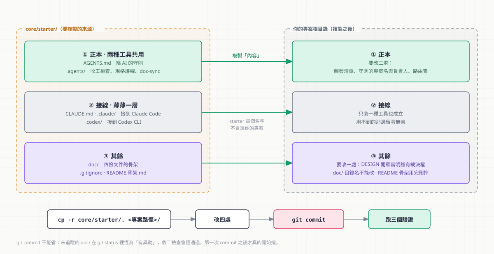
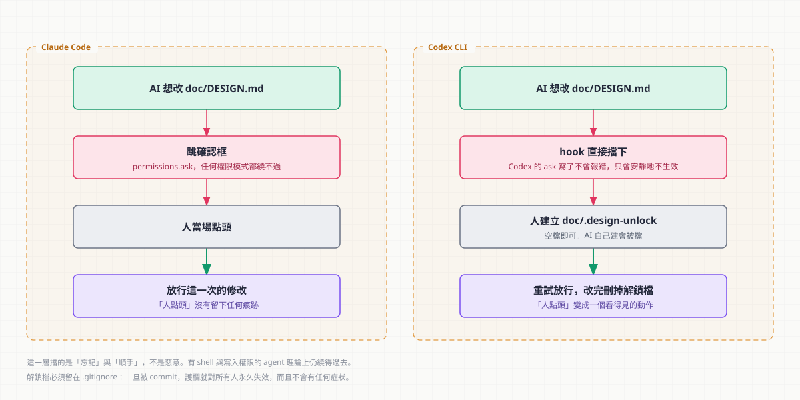
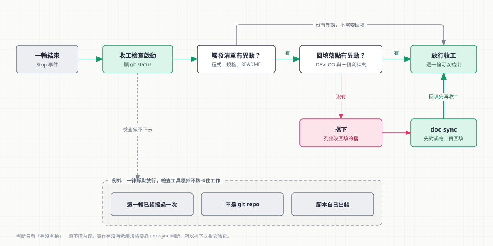

# 移植包安裝

> **必要。所有人都從這份開始。**
> 裝完之後：文件不會落後於程式，規格正本不會被 AI 單方面改寫。
> **預計耗時**：20 分鐘（複製 ＋ 改四處 ＋ 跑三個驗證）。

前置需求見 [setup/README.md](../setup/README.md) 的「前置需求」。**Node.js 沒裝就先去裝**，
hook 是 Node 寫的，沒有它整套自動化不會動。

## 裝完會得到什麼


下面的步驟就是在把這張圖裡的東西接起來：**第 1 節複製**把框裡的東西放進專案，
**第 2 節替換**讓收工檢查認得你的程式路徑，**第 4 節驗證**逐條確認圖上三種把關的線真的會擋。

---

## 這份同時適用兩種工具

starter 同時支援 **Claude Code** 與 **Codex CLI**。共用的部分佔絕大多數：

| | 共用嗎 |
|---|---|
| 守則（`AGENTS.md`）、回填流程（doc-sync skill）、收工檢查腳本 | ✅ 完全共用，一份 |
| 規格正本的保護方式 | ❌ 兩邊機制不同，見第 3 節 |

下面的步驟**只裝一種工具也完全成立** —— 用不到的那邊留著不會有任何影響
（`.codex/` 對 Claude Code 是一般檔案，反之亦然）。只有第 3 節「上線」與
第 4 節「驗證」要看你裝的是哪一邊。

---

## 1. 複製



把 `starter/` 底下的東西整份複製到專案根目錄：

```bash
cp -r starter/. <專案路徑>/
```

複製過去的東西：

複製過去的東西，分成三層看：

**① 正本（工具中立，兩種工具共用）**

| 來源 | 用途 |
|---|---|
| `AGENTS.md` | **給 AI 的工作守則正本** —— 要改守則就改這份 |
| `.agents/hooks/doc-sync-check.mjs` | 收工前檢查文件已回填。**Claude 與 Codex 跑的是這同一支** |
| `.agents/skills/doc-sync/SKILL.md` | 回填流程與路由表（正本） |
| `.agents/hooks/design-guard.mjs` | 規格正本的寫入保護（**只有 Codex 會用到**，見第 3 節） |

**② 接線（薄薄一層，把正本接到各自的工具上）**

| 來源 | 給誰 | 做什麼 |
|---|---|---|
| `CLAUDE.md` | Claude Code | 一行 `@AGENTS.md` 匯入 ＋ 兩句專屬補充 |
| `.claude/settings.json` | Claude Code | `permissions.ask` 鎖規格正本 ＋ 註冊 Stop hook |
| `.claude/skills/doc-sync/SKILL.md` | Claude Code | 四行 stub，指回 `.agents/` 的正本 |
| `.codex/config.toml` | Codex CLI | 註冊 Stop hook ＋ PreToolUse hook |

> Codex 原生就讀 `AGENTS.md`，所以它不需要對應的守則接線。

**③ 其餘**

| 來源 | 用途 |
|---|---|
| `doc/*.md` | 四份文件骨架 |
| `doc/.obsidian/app.json` | Obsidian 連結設定（不用 Obsidian 的話刪掉無妨） |
| `.gitignore` | 排除個人層設定、解鎖檔、Obsidian 工作區狀態 |
| `README.骨架.md` | 根目錄 README 的骨架，**用完要刪掉**（見第 2.1 節） |

**專案已經有 `.claude/settings.json`、`.codex/config.toml` 或 `.gitignore` 的話，
要合併不要覆蓋**：`settings.json` 併入 `permissions.ask` 與 `hooks.Stop` 兩塊，
`config.toml` 併入兩個 `[[hooks.*]]` 區塊，`.gitignore` 把幾行加進去。

> **README 骨架為什麼不直接叫 `README.md`**：因為 `cp -r` 會**無聲覆蓋**掉專案既有的
> README —— 不報錯、不問你，那份內容就沒了。換個檔名，`cp` 就碰不到它。

> ⚠️ `.gitignore` 裡的 `doc/.design-unlock` **一定要保留**。它一旦被 commit，
> Codex 那邊的規格保護就對所有人永久失效，而且不會有任何症狀。

---

## 2. 要替換的四處 ＋ 一份要建的

| # | 檔案 | 換什麼 |
|---|---|---|
| 1 | `.agents/hooks/doc-sync-check.mjs` 的 `TRIGGERS` | 換成這個專案的程式／內容路徑。檔案裡用 `═══` 框起來了，標記段落內只有這一處要改。**改一次兩種工具同時生效** |
| 2 | **`AGENTS.md`** | `<專案名>`、`<負責人>`、§3 的章號、§4 的專案性質。⚠️ **不是 `CLAUDE.md`** —— 那份只是匯入 |
| 3 | `.agents/skills/doc-sync/SKILL.md` 的路由表 | TECH 的章節編號換成實際章號 |
| 4 | `doc/DESIGN.md` 開頭條款 | `<負責人>` —— 誰有規格變動的裁決權 |

> **只裝 Codex 的話還要多看一處**：`.codex/config.toml` 裡還有一個
> `⚠ 待實機確認` 的值 —— hook 腳本的定位方式（`${CODEX_PROJECT_DIR}`）。
> 第 3 節的「Codex 路線」會說怎麼確認。
> （PreToolUse 的 `matcher` 已定案為 `.*`，**不要改成列舉工具名** ——
> 那樣一換版本就會安靜漏擋，2026-09-12 已經踩過一次。）

四份 `doc/` 骨架裡還有一堆 `<這樣>` 的佔位，那些是**內容**、邊做邊填，不算安裝步驟。

> **如果這個專案不打算拆 DEVLOG**（時序 entry 也寫在 `doc/DEVLOG.md` 裡面），
> 除了上面四處，還要改 hook 的 `GATE` —— 把 `doc/devlog/` 那三個目錄項刪掉，
> 只留 `doc/DEVLOG.md`。同時 SKILL.md 路由表的三個資料夾落點要改回章節。
> `GATE` 只有一份（在 `.agents/hooks/`），改一次兩邊都生效。

### 2.1 建立根目錄的 `README.md`

`doc/` 四份是**給做事的人與 AI 看的**，`README.md` 是**對外的進站點** ——
兩者不能互相取代，所以這一步不能省。

| 你的情況 | 做什麼 |
|---|---|
| 專案**還沒有** `README.md` | 照 `README.骨架.md` 建一份，填掉 `<>` 佔位 |
| 專案**已經有** `README.md` | ⛔ **不要整份換掉。** 只把缺的那幾節併進去，既有內容不用刪 |

必備三節（骨架裡都有，規範正本在
[`doc-sync/SKILL.md`](starter/.agents/skills/doc-sync/SKILL.md) 的「README 的必備章節」）：
**這是什麼**、**怎麼跑起來**、**文件在哪**。

弄完 `rm README.骨架.md`。留著不會有任何症狀，但下一個人會以為專案有兩份 README。

> ⚠️ **README 只放指標**。檔案清單、資料契約、驗證判準留在 `doc/` ——
> 抄一份進 README 的下場是兩邊分岔，而分岔**不會有任何工具報錯**。

---

## 3. 上線

1. 複製 ＋ 改完四處
2. **`git commit`** —— 這步不能省，見下方警告
3. 依你裝的工具做下面「各自要做的那一步」
4. 跑第 4 節的驗證

### Claude 路線

**重開 Claude Code session** —— `.claude/settings.json` 要重載才生效。

### Codex 路線

**① 信任 hook。** Codex 預設**不會執行沒被信任過的 hook**，而且不會吵你 ——
它只是安靜地不跑。開一個 session，用 `/hooks` 檢視來源、確認兩支腳本的內容，
然後 trust。信任是綁腳本雜湊的：**腳本改過就要重新 trust**（例如你剛改完 `TRIGGERS`）。

> 這是 Codex 與 Claude 最大的操作差異。沒做這一步的話，後面的驗證會全部「安靜通過」，
> 看起來像裝好了 —— 正是這套體系最怕的那種壞法。

**② 確認 `${CODEX_PROJECT_DIR}` 存不存在。** 這是 `.codex/config.toml` 裡
唯一還沒實機驗證的值，而**兩個 hook 都依賴它 —— 不存在的話會無聲失效**。
放一支拋棄式 hook 把 stdin 與環境原樣寫到檔案，跑一輪看內容：

```bash
# 暫時把 config.toml 的 command 換成這行，跑一輪後看 /tmp/probe.json
command = 'sh -c "cat > /tmp/probe.json; env | grep -i codex >> /tmp/probe.json; pwd >> /tmp/probe.json"'
```

要確認的是 `CODEX_PROJECT_DIR` 這個變數在不在。不在就把路徑改成相對路徑
（若 `pwd` 是專案根）或絕對路徑。

> ⚠️ 探測時**不要把 `CODEX_HOME` 指向專案裡的 `.codex/`** —— Codex 會把它當成
> 自己的 home，在裡面生一大包執行期狀態檔，然後被 `cp -r` 一起複製出去。
> 專案層設定 Codex 自己會讀，不需要設 `CODEX_HOME`。

> `design-guard.mjs` **比對不到就放行**，所以設定寫錯的後果是「擋不到」，不是「誤擋」。
> 但「擋不到」正是沒有症狀的那種，所以驗證 A 一定要跑。

> ## ⚠️ `doc/` 沒 commit 前，這套機制是空轉的
>
> 未追蹤的 `doc/DEVLOG.md` 在 `git status` 裡恆為「有異動」，收工閘門恆通過。
> **第一次 commit 之後才真的開始擋。**

---

## 4. 驗證：三個必跑的

### A. 規格正本的保護（最關鍵）



**兩種工具的期望行為不同**，裝哪邊就跑哪邊：

| 工具 | 做法 | 期望 |
|---|---|---|
| **Claude Code** | 叫 AI 改 `doc/DESIGN.md` 任何一個字 | **跳確認框**。切到 `acceptEdits` 模式再試一次 → **仍然要跳** |
| **Codex CLI** | 同上 | **被擋下**，訊息叫你建 `doc/.design-unlock` |

擋不住就代表這層沒生效，「規格變動由人決定」這條保障是空的。

**Codex 還要多驗解鎖檔這一段**（否則等於裝了一道打不開的門）：

```bash
touch doc/.design-unlock     # 人授權
# → 再叫 AI 改 DESIGN.md，這次應該放行
git status --porcelain -uall | grep design-unlock   # 應該沒有輸出
rm doc/.design-unlock        # 用完立刻刪
```

最後那個 `grep` 沒輸出很重要 —— 解鎖檔一旦進版控，這層保護就永久失效了。

**不裝 Codex 也可以先單測這支腳本**（不需要 Codex 環境）：

```bash
printf '%s' '{"cwd":"'$PWD'","tool_name":"apply_patch","tool_input":{"path":"doc/DESIGN.md"}}' \
  | node .agents/hooks/design-guard.mjs; echo "[exit=$?]"
```

| 情境 | 期望 |
|---|---|
| 如上 | 輸出帶 `"permissionDecision":"deny"` 的 JSON |
| 同上，但先 `touch doc/.design-unlock` | 無輸出，`exit=0` |
| 把 `path` 換成 `doc/TECH.md` | 無輸出，`exit=0`（不誤擋） |
| `tool_name` 換成 `shell`、`tool_input.command` 是 `grep foo doc/DESIGN.md` | 無輸出，`exit=0`（讀取不擋） |

### B. hook 腳本（不用等真的收工）

下面每個情境，驗的都是這張圖上的一條路徑：



```bash
echo '{"hook_event_name":"Stop","cwd":"<專案絕對路徑>","stop_hook_active":false}' \
  | node .agents/hooks/doc-sync-check.mjs; echo "[exit=$?]"
```

（兩種工具跑的是這同一支，所以這九個情境只要測一次。）

每個情境之間記得改動工作區再跑一次：

| 情境 | 期望 |
|---|---|
| 乾淨工作區 | 無輸出，`exit=0` |
| 改一行程式，文件全沒動 | 輸出 `{"decision":"block",...}`，reason 列到那個檔 |
| 同上 ＋ 動 `doc/DEVLOG.md` | 無輸出，`exit=0` |
| 同上 ＋ 只新增 `doc/devlog/<今天>.md` | 無輸出，`exit=0` |
| 同上 ＋ 只新增 `doc/decisions/<某決策>.md` | 無輸出，`exit=0` |
| 同上 ＋ 只新增 `doc/gotchas/<某坑>.md` | 無輸出，`exit=0` |
| 改 `doc/DESIGN.md`，文件全沒動 | 擋，且 reason 帶規格正本的兩點提醒 |
| 前述擋下情境 ＋ `stop_hook_active: true` | 無輸出，`exit=0`（迴圈守門有效） |
| 只改不相干檔案 | 無輸出，`exit=0`（不干擾） |

### C. 衝突升報端到端（這條沒過，整套等於沒做）

故意製造一個牴觸 —— 把程式裡某個 DESIGN 有寫死的數值改掉，然後叫 AI 回填文件。

**期望它停下來，給出「規格怎麼寫／實作變成怎樣／出處」那張表加三個選項，
而不是默默把 DESIGN 改成符合實作。**

測完 `git checkout <那個檔>` 還原。

---

## 5. 完成檢查清單

**共同**

- [ ] `starter/` 內容已複製到專案根目錄
- [ ] 四處替換都做了（TRIGGERS／**AGENTS.md**／SKILL 路由表／DESIGN 負責人）
- [ ] 根目錄有 `README.md`，「文件在哪」那節指得到 `doc/` 四份；`README.骨架.md` 已刪掉
- [ ] 判斷過要不要開美術指南 `doc/ART.md`，結論寫在 PLAN「素材需求與版權」（開的話照 [美術指南.md](美術指南.md) 接上）
- [ ] 已 `git commit`（**沒 commit 等於沒裝**）
- [ ] 驗證 B：九個情境的輸出都符合預期
- [ ] 驗證 C：AI 遇到規格牴觸會停下來升報，不會自行改 DESIGN

**裝 Claude Code 的話**

- [ ] 已重開 Claude Code session
- [ ] 驗證 A：`acceptEdits` 模式下改 DESIGN 仍會跳確認框

**裝 Codex CLI 的話**

- [ ] 已用 `/hooks` 檢視並 trust 兩支 hook（**改過腳本要重新 trust**）
- [ ] `.codex/config.toml` 兩個 `⚠ 待實機確認` 的值已確認並改成實際值
- [ ] 驗證 A：改 DESIGN 被擋；`touch doc/.design-unlock` 後放行
- [ ] `git status` 看不到 `doc/.design-unlock`

---

## 6. 常見問題

**Q：hook 完全沒有反應**
先確認有沒有 `git commit`（見上方警告）。
Claude Code：確認 session 是否已重開。
**Codex：確認 hook 已經 trust 過**（`/hooks`）—— 沒信任的 hook 是**安靜地不執行**的，
這是 Codex 最常見的「看起來裝好了其實沒裝」。腳本改過也要重新 trust。
都做了還是沒反應，手動跑一次驗證 B 的指令看 exit code。

**Q：`node` 找不到**
Node.js 沒裝，或裝了但不在 PATH。受管電腦不能自行安裝，請管理員協助。

**Q：hook 擋了但我這次真的不需要回填**
它只擋一次（`stop_hook_active` 守門防迴圈），再結束一次就過。這是刻意的 ——
保證的是「一定會被提醒一次」，不是「絕對不可能漏」。

**Q：上週 commit 了程式但沒回填，hook 抓不到**
hook 只看工作區，不看已 commit 的歷史。要補就手動
`git log --oneline` 從最後一則 devlog entry 之後看起。

**Q：可以改成 commit 時才擋嗎（pre-commit hook）**
不建議。`.git/hooks/` 不進版控、換機器要重裝，而且 commit 當下被擋很煩。
收工 hook 的時機更早也更好改。

**Q：Codex 為什麼不能像 Claude 一樣跳確認框問我**
它的 PreToolUse hook 只支援 `allow` 與 `deny`，`"ask"` 官方標示為
*parsed but not supported yet* —— 寫了不會報錯，只會安靜地不生效。
所以改用「硬擋 ＋ 解鎖檔」，理由見 [README.md](../README.md) 的「三層裝置怎麼運作」。

**Q：兩種工具都裝，會不會打架**
不會。`.claude/` 與 `.codex/` 各自只被自己的工具讀，`.agents/` 底下的正本兩邊共用。
唯一要記得的是：改 `TRIGGERS`／`GATE`／路由表只改 `.agents/` 那一份，
**不要複製第二份出來** —— 複製出來就會開始漂移，而漂移不會有任何工具報錯。

**Q：`doc/.design-unlock` 可以一直留著嗎**
技術上可以，但那等於把 Codex 的規格保護永久關掉。它的設計意圖是**一次性手勢**：
建 → 改 → 刪。留著不會有任何症狀，所以這條只能靠紀律。

**Q：AI 自己 `touch` 一個解鎖檔不就繞過去了**
`design-guard.mjs` 會擋掉「用工具建立解鎖檔」這條最直接的路。
但老實說：**解鎖檔是協作慣例與防呆，不是安全邊界** ——
有 shell 與寫入權限的 agent 理論上仍有別的辦法。它擋的是「忘記」與「順手」，
不是惡意。要真正強制人類授權，得靠 CLI 的人工 approval 流程。
