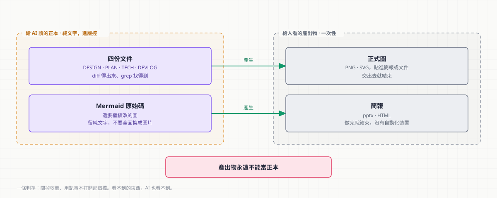

# extras/ — ChiaoFlow Extras

> **全部選用，沒有先後順序，沒有一個依賴 [Core](../core/)。**
> 這些是**我個人的工作習慣** —— 挑你要的拿，一樣都不拿也完全沒關係。
> 前置是 [../setup/](../setup/) 的 Claude Code CLI。
> ⚠️ **Extras 與 Core 不同，沒有做雙工具適配** —— 部分路線是 Claude Code plugin，
> Codex 下沒有現成對應。哪些通用、哪些不通用見下方「哪些在 Codex 下也能用」。
> 為什麼一份講文件的手冊要管圖與簡報，見 [../README.md](../README.md)「為什麼要管圖與簡報」。

---

## 有哪些

| 你的情況 | 要讀 | 大約耗時 |
|---|---|---|
| AI 給的 Mermaid 圖沒人看得懂／要一張放得進簡報的圖 | [圖表工具.md](圖表工具.md) | 10 分鐘 |
| **簡報做出來目的不明確、資訊太雜、老是要再修一輪** | **[簡報/規劃.md](簡報/規劃.md)** ⭐ | 15 分鐘 |
| 要做一份能站上去講的簡報（選工具） | [簡報/製作.md](簡報/製作.md) | 10 分鐘 |
| 想知道編輯器裡有哪幾個外掛值得裝 | [VSCode外掛.md](VSCode外掛.md) | 5 分鐘 |

[簡報](簡報) 是**要複製出去用的**（大綱範本 ＋ 出片腳本），
複製到**你自己的簡報工作資料夾**，不是裝進專案。

---

## 哪些在 Codex 下也能用

[Core](../core/) 兩種工具通用，但 Extras **不是** —— 它有幾項綁在 Claude Code 的外掛機制上：

| 東西 | Codex 下可用嗎 |
|---|---|
| [簡報/規劃.md](簡報/規劃.md) 的整套 SOP（場合卡、逐頁大綱表、頁數預算） | ✅ **通用** —— 那是紙上流程，跟工具無關 |
| [簡報/範本/大綱.md](簡報/範本/大綱.md) | ✅ 通用，純 Markdown |
| `簡報/工具/` 底下的五支 Python 腳本（密度檢查、出 pptx、出 HTML） | ✅ 通用，只依賴 Python ＋ `python-pptx` |
| [簡報/製作.md](簡報/製作.md) 的 **Route A（frontend-slides）** | ❌ Claude Code plugin |
| [圖表工具.md](圖表工具.md) 的 **diagram-design** | ❌ Claude Code plugin |
| [VSCode外掛.md](VSCode外掛.md) | ✅ 與 CLI 無關 |

**這一包最有價值的部分（SOP 與判準）是通用的**，擋住的只有兩個產圖／出片的外掛。
用 Codex 的話，那兩處自己找對應工具，流程照走。

---

## 兩件要知道的事

**Extras 不在你的專案裡留下任何檔案。** 它們裝在你的使用者層（`~/.claude/`），
產出物（圖、簡報）要不要進版控由你決定 —— 跟 Core 那棵樹無關。
唯一的例外是 [簡報/範本/大綱.md](簡報/範本/大綱.md)，那是複製到你自己的簡報工作資料夾用的。

> ⚠️ **不要因為「看起來比較完整」就全部做完。** 最常見的失敗是花三週調環境而不是寫文件。
> 先把 Core 裝起來用一週，真的覺得缺什麼再回來加。
> **等到你手上真的有一張圖要交出去，再回來讀那一份。**

---

## 一條分界管住整個 Extras

> **這張圖是「還要繼續改的原始碼」，還是「要交出去的產出物」？**

前者留 Mermaid —— 純文字、進版控、diff 得出來、AI 讀得到，全部是優點。
後者才轉成正式圖。**不要把 Mermaid 全面消滅**，那是把成本花在不痛的地方。

同一條分界也決定了 Extras **沒有自動化裝置**：
Core 有 hook 與權限規則，是因為「文件落後於程式」每天都在發生；
Extras 是**一次性的產出**，做完就結束了，裝閘門沒有東西可以擋。

---

## 選工具時只有兩條判準

因為這個工具包**會被傳給協作者或合作對象**，而對方很可能用的是受管電腦（由組織配發、沒有管理員權限）：

| 判準 | 為什麼 |
|---|---|
| **授權能不能傳給別人** | 在說明文件裡叫別人裝一個授權要另外讀的東西，是把問題丟給下一個人 |
| **受管電腦裝不裝得起來** | 沒有本機管理員權限就裝不了外部執行檔。要為了一張圖去跑申請流程，這條路實務上不會被走完 |

這兩條判準否決掉的最主要候選是 Anthropic 官方的 pptx 技能（**Proprietary 授權**）。

> ⚠️ **2026-08-27 更正**：原本還寫了「需要 LibreOffice 與 Poppler 兩個外部執行檔」。
> 查證後那是錯的 —— **建 pptx 不需要那兩個**，它們只用在縮圖與驗證這兩個可選步驟。
> 擋掉它的是授權那一條，而授權自己就足以否決。理由寫錯會讓下一個人在授權變了之後
> 仍然不敢用，所以留著這則更正而不是直接刪掉。

它產出的**可編輯 pptx** 一度是其他方案給不了的 —— 那件事現在有免費的做法了，
見 [簡報/規劃.md](簡報/規劃.md)。完整的比較與沒選的其他方案記在 [簡報/製作.md](簡報/製作.md)。

### 還有一條隱形的：內容不要離開你的機器

線上 Mermaid 編輯器、公開的 PlantUML 伺服器、把簡報部署到 Vercel ——
這三件事都是「按一下就完成」，也都是**把內容送到外部服務**。

Extras 選定的主線刻意避開了它們：diagram-design 的 Mermaid 匯入是純本機解析，
**不 render、不執行、不連網**；產出的 HTML 也不依賴任何外部資源。
每份 SOP 裡有這個風險的操作都標了 ⚠️。
